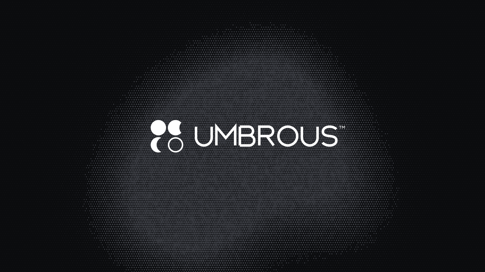

# Umbrous brand

**Eclipse grid** — four circle modules with one umbra sweeping across them: full, waning, crescent, gone.

| File | Use |
|---|---|
| `logo/umbrous-lockup-white.svg` | Primary logo on dark backgrounds |
| `logo/umbrous-lockup-black.svg` | Logo on light backgrounds |
| `logo/umbrous-symbol-white.svg` / `-black.svg` | Symbol only (avatars, icons) |
| `logo/umbrous-hero.png` | 1920×1080 hero on the halftone background |

Status: concept artwork. Before final release, the wordmark strokes need expanding to outlines, and a simplified
single-crescent version is needed for 16 px favicons.
